<a href="https://fortress07.github.io/profile/#gh-dark-mode-only"></a>

<a href="assets/dark/about.svg#gh-dark-mode-only">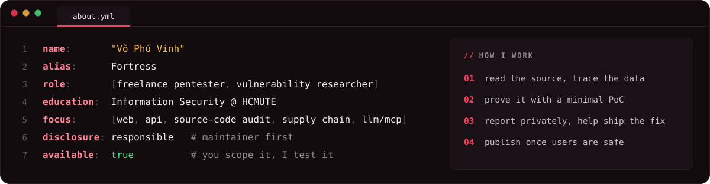</a>

<a href="assets/dark/achievements.svg#gh-dark-mode-only"></a>

<a href="https://github.com/cbcoutinho/nextcloud-mcp-server/security/advisories/GHSA-8vh3-g2qg-2h2c#gh-dark-mode-only">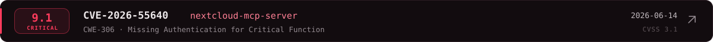</a>

<a href="https://github.com/mapbox/pbf/pull/149#gh-dark-mode-only">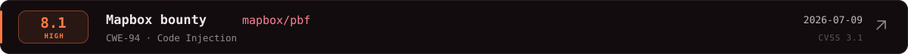</a>
<a href="https://github.com/netboxlabs/netbox-mcp-server/security/advisories/GHSA-5qg7-j8mr-9477#gh-dark-mode-only">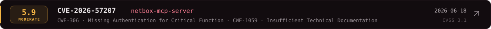</a>

<a href="assets/dark/section-projects.svg#gh-dark-mode-only">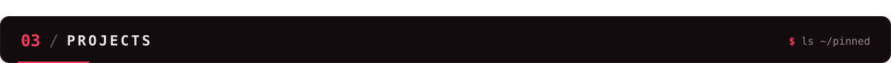</a>

  <a href="https://github.com/fortress07/fortress-scan#gh-dark-mode-only">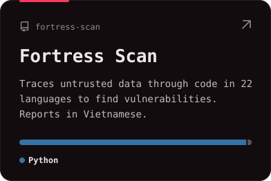</a>
  <a href="https://github.com/fortress07/LLM-Data-Poisoning-Simulation-Sandbox#gh-dark-mode-only">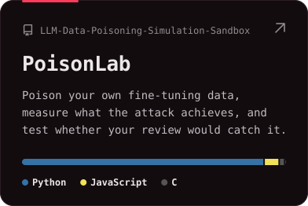</a>
  <a href="https://github.com/fortress07/project_S-Graph#gh-dark-mode-only">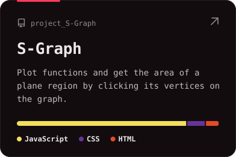</a>

<a href="assets/dark/section-arsenal.svg#gh-dark-mode-only">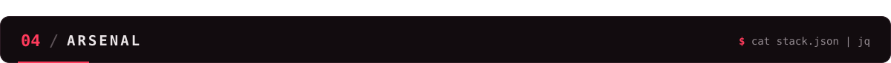</a>

<a href="assets/dark/section-links.svg#gh-dark-mode-only">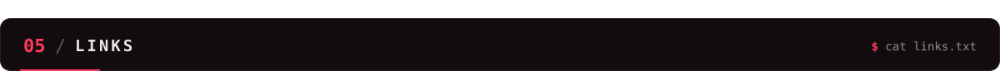</a>

  
  
  <a href="https://fortress07.github.io/profile/#gh-dark-mode-only">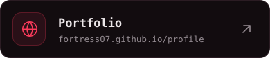</a>
  
  
  

