<picture><source media="(prefers-color-scheme: dark)" srcset="assets/dark/banner.svg"><a href="https://fortress07.github.io/profile/"></a></picture>

<picture><source media="(prefers-color-scheme: dark)" srcset="assets/dark/section-whoami.svg">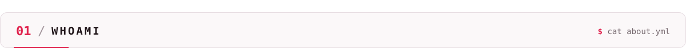</picture>

<picture><source media="(prefers-color-scheme: dark)" srcset="assets/dark/about.svg">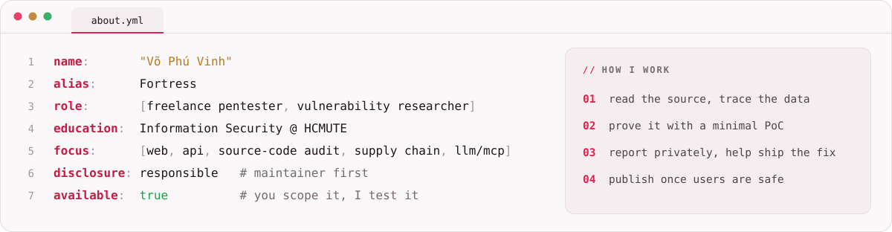</picture>

<picture><source media="(prefers-color-scheme: dark)" srcset="assets/dark/section-hall-of-fame.svg">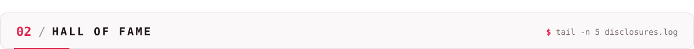</picture>

<picture><source media="(prefers-color-scheme: dark)" srcset="assets/dark/achievements.svg"></picture>

<picture><source media="(prefers-color-scheme: dark)" srcset="assets/dark/cve-55640.svg"><a href="https://fortress07.github.io/profile/#/wu-55640">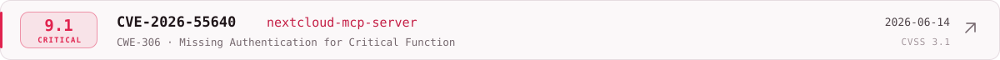</a></picture>
<picture><source media="(prefers-color-scheme: dark)" srcset="assets/dark/cve-55849.svg"><a href="https://fortress07.github.io/profile/#/wu-55849">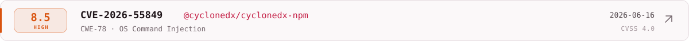</a></picture>
<picture><source media="(prefers-color-scheme: dark)" srcset="assets/dark/cve-71538.svg"><a href="https://fortress07.github.io/profile/#/wu-71538">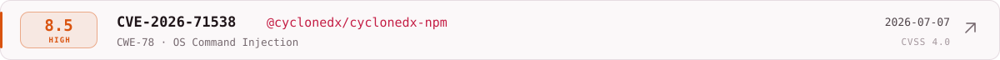</a></picture>
<picture><source media="(prefers-color-scheme: dark)" srcset="assets/dark/cve-pbf.svg"><a href="https://fortress07.github.io/profile/#/wu-h1-pbf">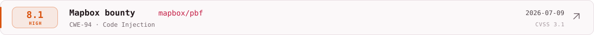</a></picture>
<picture><source media="(prefers-color-scheme: dark)" srcset="assets/dark/cve-57207.svg"><a href="https://fortress07.github.io/profile/#/wu-57207">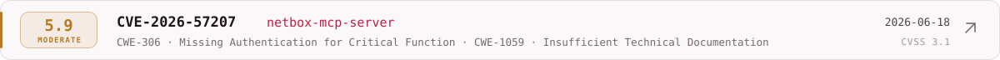</a></picture>

<picture><source media="(prefers-color-scheme: dark)" srcset="assets/dark/section-projects.svg">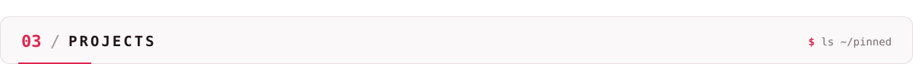</picture>

  <picture><source media="(prefers-color-scheme: dark)" srcset="assets/dark/project-fortress-scan.svg"><a href="https://github.com/fortress07/fortress-scan">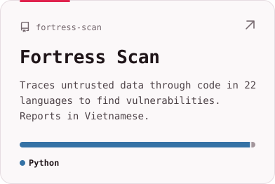</a></picture>
  <picture><source media="(prefers-color-scheme: dark)" srcset="assets/dark/project-poisonlab.svg"><a href="https://github.com/fortress07/LLM-Data-Poisoning-Simulation-Sandbox">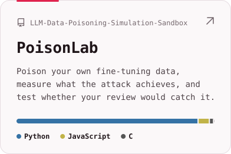</a></picture>
  <picture><source media="(prefers-color-scheme: dark)" srcset="assets/dark/project-s-graph.svg"><a href="https://github.com/fortress07/project_S-Graph">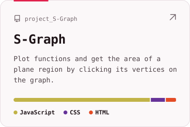</a></picture>

<picture><source media="(prefers-color-scheme: dark)" srcset="assets/dark/section-arsenal.svg">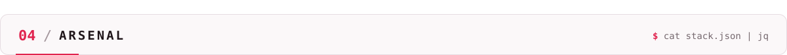</picture>

<picture><source media="(prefers-color-scheme: dark)" srcset="assets/dark/stack.svg">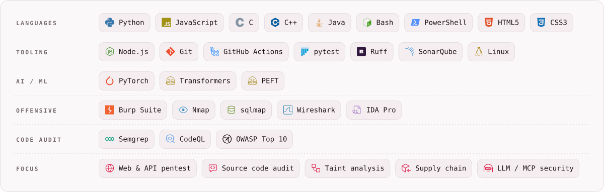</picture>

<picture><source media="(prefers-color-scheme: dark)" srcset="assets/dark/section-links.svg"></picture>

  <picture><source media="(prefers-color-scheme: dark)" srcset="assets/dark/contact-email.svg"></picture>
  <picture><source media="(prefers-color-scheme: dark)" srcset="assets/dark/contact-hackerone.svg"></picture>
  <picture><source media="(prefers-color-scheme: dark)" srcset="assets/dark/contact-portfolio.svg"></picture>
  <picture><source media="(prefers-color-scheme: dark)" srcset="assets/dark/contact-facebook.svg"></picture>
  <picture><source media="(prefers-color-scheme: dark)" srcset="assets/dark/contact-instagram.svg"></picture>
  <picture><source media="(prefers-color-scheme: dark)" srcset="assets/dark/contact-tiktok.svg"></picture>

<picture><source media="(prefers-color-scheme: dark)" srcset="assets/dark/footer.svg">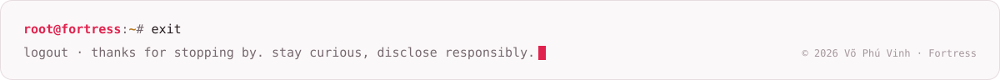</picture>
