## 01. About me

- Information Security student at **HCMUTE**, Ho Chi Minh City.
- **Finalist** (Consolation Prize) at the Cybersecurity Student Contest (CSC) 2026, Group A.
- **1st place** at HCMUTE Capture the Flag (UTECTF) 2026.
- Freelance pentester: web and API testing, source code audit, LLM and MCP security.
- Vulnerability researcher with **4 CVEs** and **1 bug bounty** on HackerOne.
- Responsible disclosure: report privately, help ship the fix, publish once users are safe.

## 02. Achievements

| | Result | Event |
|:-:|---|---|
|  | **Finalist** · Consolation Prize | Cybersecurity Student Contest (CSC) 2026 · Group A |
|  | **1st Place** · Champion | HCMUTE Capture the Flag (UTECTF) 2026 |
|  | **1x Bounty** · Mapbox · HackerOne |  |
|  | **4x CVE** · Responsible disclosure |  |

## 03. Vulnerability disclosures

| CVSS | Finding | Weakness | Date |
|:-:|---|---|:-:|
|  | [**CVE-2026-55640**](https://fortress07.github.io/profile/#/wu-55640) <code>nextcloud-mcp-server</code> | CWE-306 Missing Authentication | 2026-06-14 |
|  | [**CVE-2026-55849**](https://fortress07.github.io/profile/#/wu-55849) <code>@cyclonedx/cyclonedx-npm</code> | CWE-78 OS Command Injection | 2026-06-16 |
|  | [**CVE-2026-71538**](https://fortress07.github.io/profile/#/wu-71538) <code>@cyclonedx/cyclonedx-npm</code> | CWE-78 OS Command Injection | 2026-07-07 |
|  | [**Mapbox bounty**](https://fortress07.github.io/profile/#/wu-h1-pbf) <code>mapbox/pbf</code> | CWE-94 Code Injection | 2026-07-09 |
|  | [**CVE-2026-57207**](https://fortress07.github.io/profile/#/wu-57207) <code>netbox-mcp-server</code> | CWE-306 Missing Authentication CWE-1059 Insufficient Documentation | 2026-06-18 |

## 04. Projects

| Project | What it does | Language |
|---|---|---|
| [**Fortress&nbsp;Scan**](https://github.com/fortress07/fortress-scan) | Traces untrusted data through code in 22 languages to find vulnerabilities. Reports in Vietnamese. | Python |
| [**PoisonLab**](https://github.com/fortress07/LLM-Data-Poisoning-Simulation-Sandbox) | Poison your own fine-tuning data, measure what the attack achieves, and test whether your review would catch it. | Python JavaScript C |
| [**S-Graph**](https://github.com/fortress07/project_S-Graph) | Plot functions and get the area of a plane region by clicking its vertices on the graph. | JavaScript CSS HTML |

## 05. Languages & tools

### Languages

| Python | JavaScript | C | C++ | Java |
|:-:|:-:|:-:|:-:|:-:|
|  |  |  |  |  |
| **Pascal** | **Bash** | **PowerShell** | **HTML5** | **CSS3** |
|  |  |  |  |  |

### Tooling

| Node.js | Git | GitHub Actions | pytest |
|:-:|:-:|:-:|:-:|
|  |  |  |  |
| **Ruff** | **SonarQube** | **Linux** |  |
|  |  |  |  |

### AI / ML

| PyTorch | Transformers | PEFT |
|:-:|:-:|:-:|
|  |  |  |

### Offensive

| Burp Suite | Nmap | sqlmap | Wireshark | IDA Pro |
|:-:|:-:|:-:|:-:|:-:|
|  |  |  |  |  |

### Infra & defense

| Docker | pfSense | Suricata |
|:-:|:-:|:-:|
|  |  |  |

### Code audit

| Semgrep | CodeQL | OWASP Top 10 |
|:-:|:-:|:-:|
|  |  |  |

### Focus areas

| Web & API pentest | Source code audit | Taint analysis | Supply chain | LLM / MCP security |
|:-:|:-:|:-:|:-:|:-:|
|  |  |  |  |  |

## 06. Links

| | Channel | Address |
|:-:|---|---|
|  | **Email** | [vophuvinh15012007@gmail.com](mailto:vophuvinh15012007@gmail.com) |
|  | **HackerOne** | [hackerone.com/fortress07vn](https://hackerone.com/fortress07vn) |
|  | **Portfolio** | [fortress07.github.io/profile](https://fortress07.github.io/profile/) |
|  | **Facebook** | [facebook.com/f0r7r355](https://www.facebook.com/f0r7r355) |
|  | **Instagram** | [instagram.com/f0r7r355](https://www.instagram.com/f0r7r355) |
|  | **TikTok** | [tiktok.com/@fortress.vn](https://www.tiktok.com/@fortress.vn) |

<samp>[*] session closed · stay curious, disclose responsibly</samp>

