<a href="https://fortress07.github.io/profile/"></a>

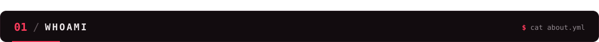

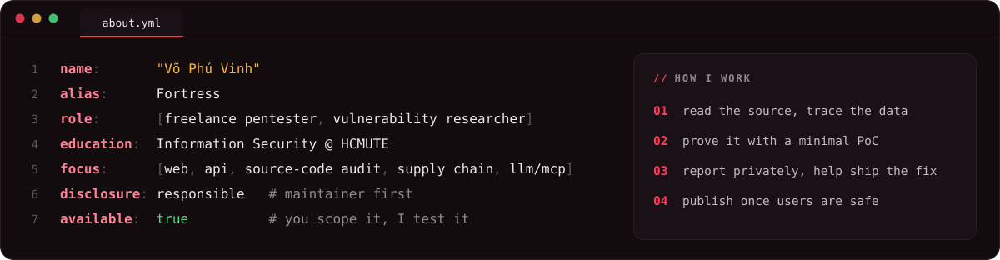

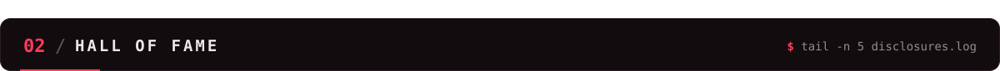

<a href="https://fortress07.github.io/profile/#/wu-55849">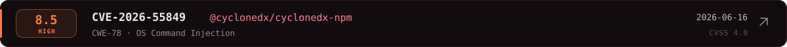</a>

<a href="https://fortress07.github.io/profile/#/wu-h1-pbf">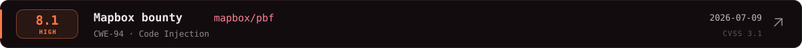</a>
<a href="https://fortress07.github.io/profile/#/wu-57207">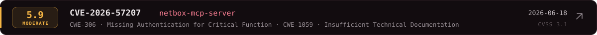</a>

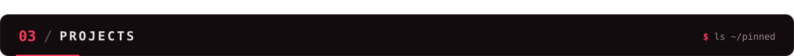

  
  <a href="https://github.com/fortress07/LLM-Data-Poisoning-Simulation-Sandbox">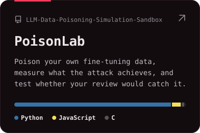</a>
  

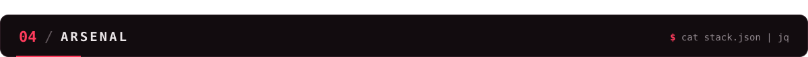

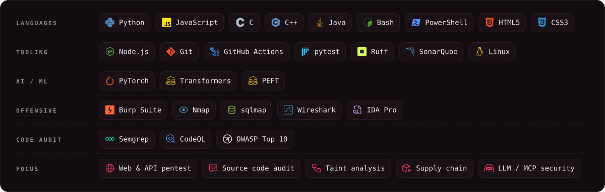

  
  <a href="https://hackerone.com/fortress07vn">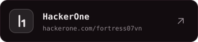</a>
  <a href="https://fortress07.github.io/profile/">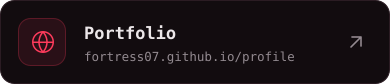</a>
  
  
  <a href="https://www.tiktok.com/@fortress.vn">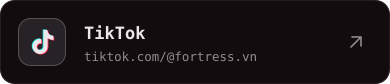</a>

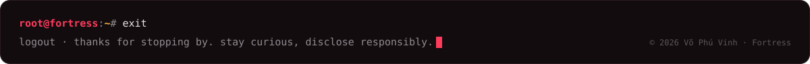
